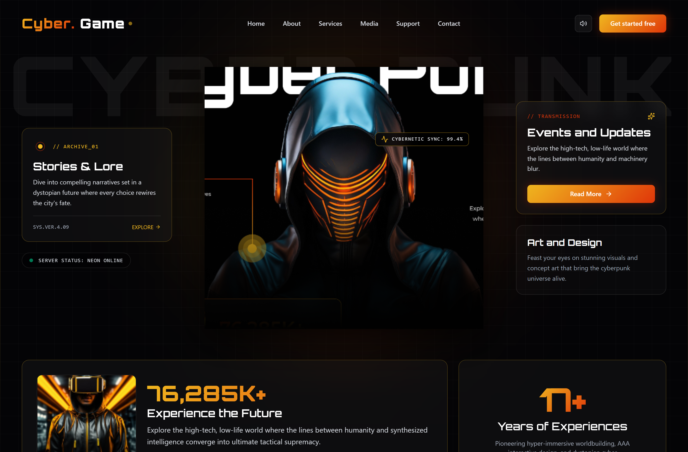
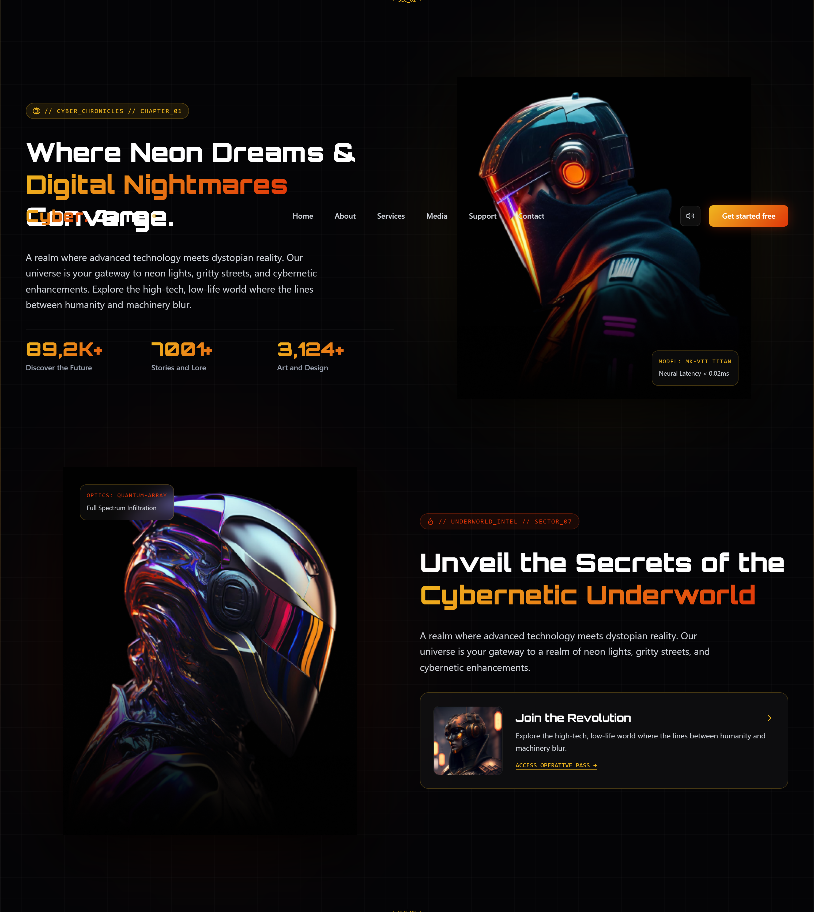
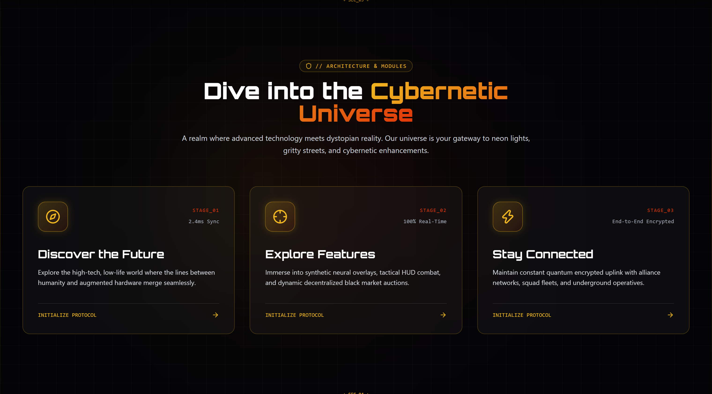
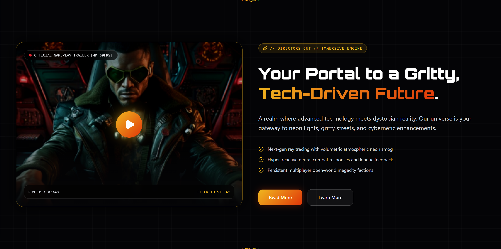
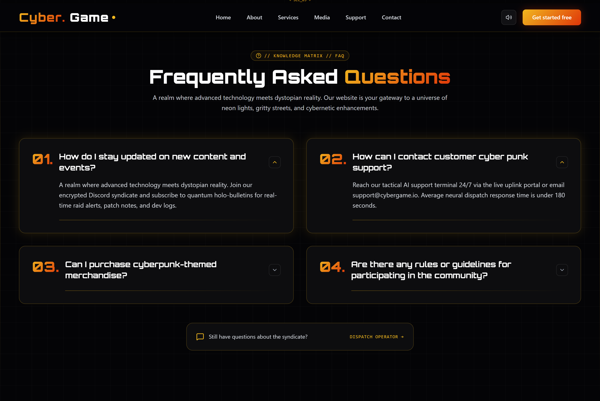
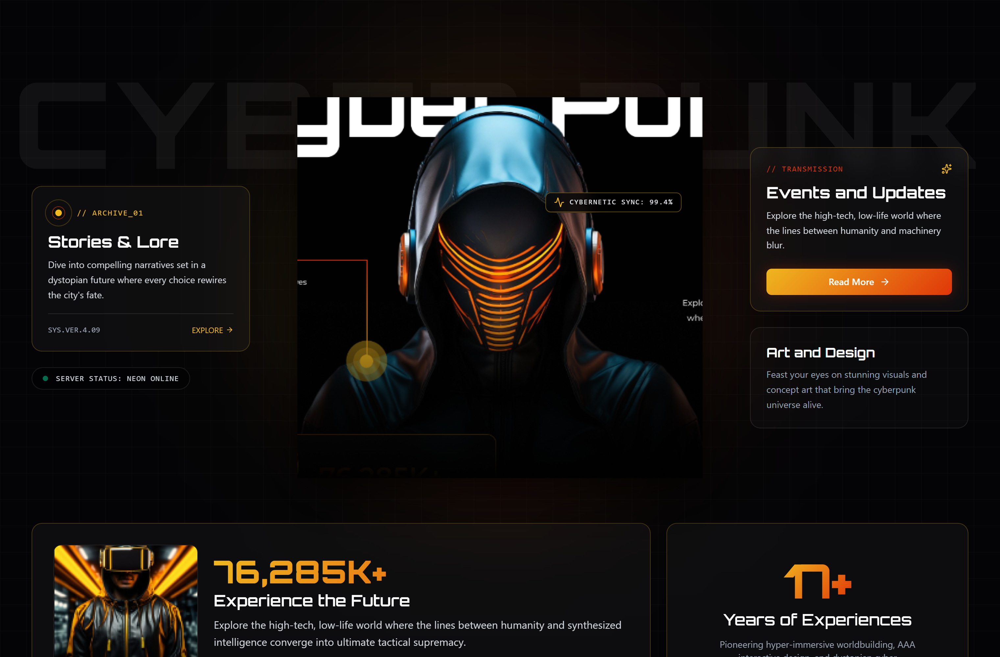
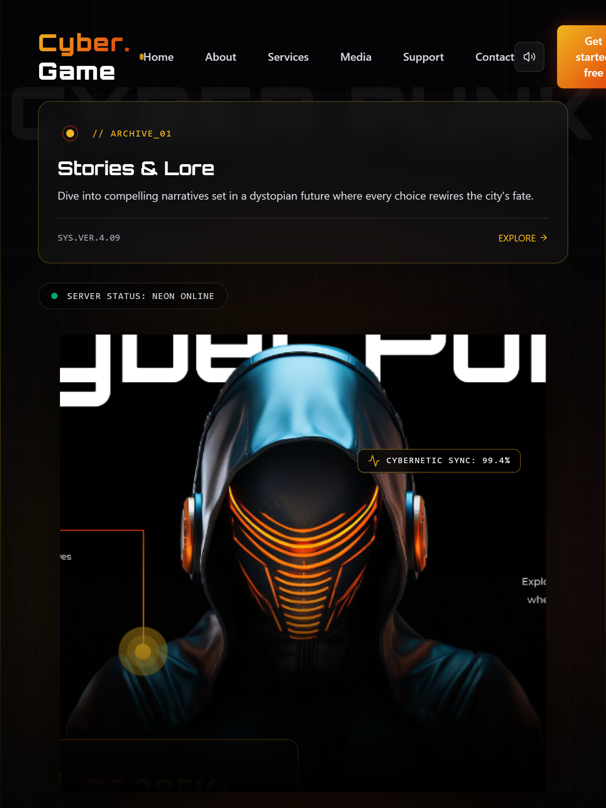
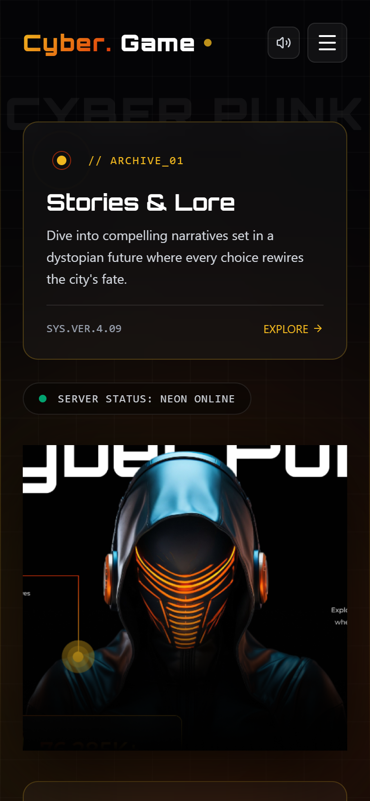

# ⚡ Cyber.Game — Futuristic Dystopian Cyberpunk Universe

[](https://react.dev/)
[](https://vitejs.dev/)
[](https://tailwindcss.com/)
[](LICENSE)
[](https://www.figma.com/design/wnXnsXTBncHG2oIWjkouvw/Cyber-Punk-Website-UI---UX-Design--Community-)

A hyper-immersive, AAA-grade front-end landing page created from the Figma Community design **"Cyber Punk Website UI / UX Design"**. Engineered with modern **React (JSX)**, **Tailwind CSS v4**, synthesized **Web Audio API** sound effects, interactive 4K video modals, dynamic faction selector, and responsive glassmorphism HUD interfaces.

---

## 📸 Visual Showcase & Screenshots

### 🖥️ Desktop Hero & Tactical HUD


### 📜 About & Cybernetic Lore (Neon Dreams & Underworld Helmets)


### ⚙️ Services & Tactical Modules


### 🎬 4K Cinematic Trailer Portal


### ❓ Knowledge Matrix & Interactive FAQs


### 🪪 Operative Registration & Faction Claim Modal


### 📱 Responsive Breakpoints
| 📱 Tablet Viewport (768px) | 📲 Mobile Viewport (iPhone 14 Pro 390px) |
| :---: | :---: |
|  |  |

---

## 🌟 Key Features

- **100% Pixel-Perfect Figma Conversion**: Exact extraction of layout coordinates, color gradients (`#F0B71F` Amber to `#E03609` Cyber-Red), fonts (`Orbitron`, `Montserrat`, `Rajdhani`), and 3D visual assets.
- **Synthesized Web Audio API Sound Effects**: Zero external audio downloads; procedural futuristic feedback on hover, click, and pass generation with toggle mute support.
- **Interactive Modals**:
  - **4K Cinematic Trailer Screen**: Holographic simulated video player with stream telemetry.
  - **Operative Registration Pass**: Multi-faction selection (*Chrome Titan*, *Cyber Ghost*, *Neon Viper*) with `canvas-confetti` celebrations.
- **Cinematic Wide Banner**: Interactive protocol selector that dynamically highlights lore and tactical codes.
- **Expandable FAQ Accordion**: Interactive Q&A matrix answering queries about syndicate raids, support, and merchandise.
- **Glassmorphism & Neon HUD Reticles**: Concentric radar indicators, technical coordinate guidelines, and custom scrollbar styling.
- **Fully Responsive**: Flawless experience from ultra-wide 4K displays down to modern smartphones.

---

## 🛠️ Tech Stack

- **Framework**: React 19 (JSX)
- **Bundler**: Vite 6.x
- **Styling**: Tailwind CSS v4 + PostCSS
- **Typography**: Google Fonts (*Orbitron*, *Montserrat*, *Rajdhani*)
- **Icons**: Lucide React + Custom Inline Vector SVGs
- **FX**: Web Audio API Procedural Synthesizer, Canvas Confetti
- **Automation / Verification**: Puppeteer Core (Chromium Headless)

---

## 🚀 Quick Start

### 1. Clone the repository
```bash
git clone https://github.com/lxlnimalxl/cyber-game-landing.git
cd cyber-game-landing
```

### 2. Install dependencies
```bash
npm install
```

### 3. Run development server
```bash
npm run dev
```
Open `http://localhost:5181/` in your browser.

### 4. Build for production
```bash
npm run build
```

---

## 📂 Project Architecture

```
n8/
├── screenshots/               # High-resolution section & responsive captures
├── src/
│   ├── assets/
│   │   └── images/            # Exported Figma 3D character & helmet assets
│   ├── components/
│   │   ├── common/
│   │   │   └── Navbar.jsx     # Navigation, audio toggles & mobile menu
│   │   ├── modals/
│   │   │   ├── GetStartedModal.jsx # Faction pass generator + confetti
│   │   │   └── TrailerModal.jsx    # Cinematic stream preview
│   │   └── sections/
│   │       ├── HeroSection.jsx     # Hero character, watermark & HUD cards
│   │       ├── AboutSection.jsx    # 2-part cyber helmet showcase & lore
│   │       ├── BannerSection.jsx   # Wide cinematic banner with selector
│   │       ├── ServicesSection.jsx # 3 Tactical service modules
│   │       ├── MediaSection.jsx    # Gameplay trailer preview & specs
│   │       ├── FAQSection.jsx      # 2x2 Accordion matrix
│   │       └── Footer.jsx          # Brand links, newsletter & social icons
│   ├── utils/
│   │   └── audio.js           # Procedural Web Audio API sound FX
│   ├── App.jsx                # Layout orchestrator with HUD guidelines
│   ├── index.css              # Cyberpunk gradients & glass utilities
│   └── main.jsx
├── capture_screenshots.cjs     # Automated multi-viewport screenshot engine
├── index.html                 # Futuristic Google Fonts & meta tags
├── package.json
└── vite.config.js             # Tailwind CSS v4 Vite integration
```

---

## 🎨 Design Attribution

- Original UI/UX Design by **Haris Khursheed** on Figma Community:
  [Cyber Punk Website UI / UX Design](https://www.figma.com/design/wnXnsXTBncHG2oIWjkouvw/Cyber-Punk-Website-UI---UX-Design--Community-?node-id=0-1)

---

## 📄 License

MIT License © 2026 [lxlnimalxl](https://github.com/lxlnimalxl)
